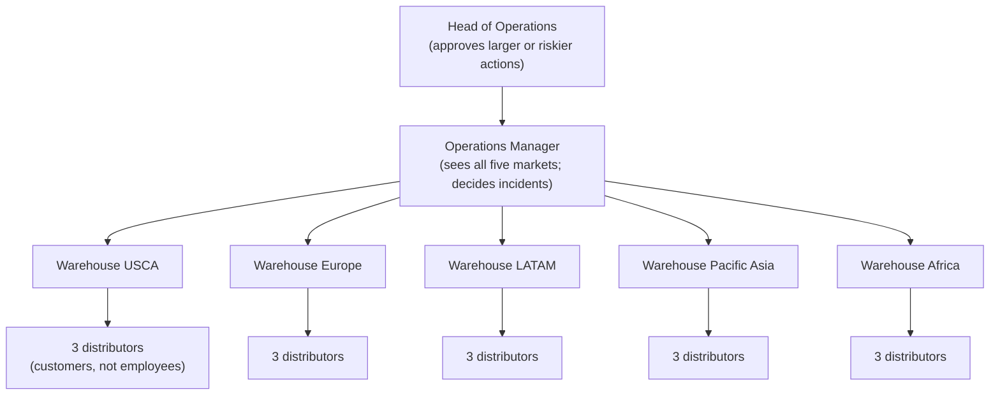
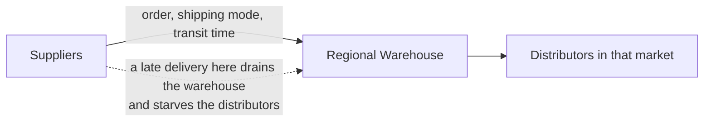
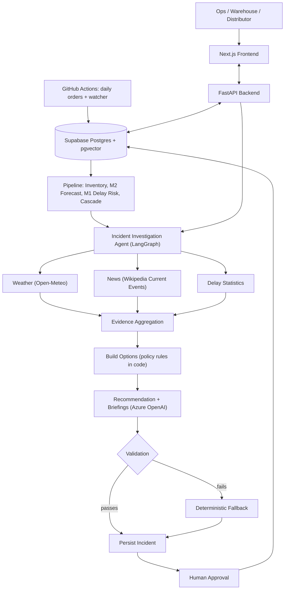

# RunOut

**Catch late shipments before they run out.**

RunOut is an early-warning system for NorthStack Logistics. It predicts which in-transit orders will arrive late, works out which warehouse will run out of which product because of those delays, sends an AI agent to investigate, and puts a ranked set of options in front of a human who makes the final decision.


---

## Table of contents

1. [Project brief and problem statement](#1-project-brief-and-problem-statement)
2. [How we simulated NorthStack with the DataCo dataset](#2-how-we-simulated-northstack-with-the-dataco-dataset)
3. [Who is who: distributors, warehouses, operations](#3-who-is-who-distributors-warehouses-operations)
4. [System overview and architecture](#4-system-overview-and-architecture)
5. [The data model](#5-the-data-model)
6. [The machine-learning models (M1 and M2)](#6-the-machine-learning-models-m1-and-m2)
7. [The cascade: from a late order to a stockout](#7-the-cascade-from-a-late-order-to-a-stockout)
8. [The investigation agent](#8-the-investigation-agent)
9. [Human in the loop](#9-human-in-the-loop)
10. [The RAG knowledge system](#10-the-rag-knowledge-system)
11. [Ask RunOut](#11-ask-runout)
12. [Observability: SHAP, MLflow, Langfuse and the Hub](#12-observability-shap-mlflow-langfuse-and-the-hub)
13. [Features](#13-features)
14. [Tech stack](#14-tech-stack)
15. [Automation: how data arriving triggers everything](#15-automation-how-data-arriving-triggers-everything)
16. [Setup](#16-setup)
17. [Deployment](#17-deployment)
18. [API reference](#18-api-reference)
19. [Project structure](#19-project-structure)
20. [Responsible AI and known limits](#20-responsible-ai-and-known-limits)
21. [Future work](#21-future-work)

---

## 1. Project brief and problem statement

### The company

NorthStack is a (fictional) sporting-goods business that has branched into logistics. It now runs five regional warehouses, one per market (USCA, Europe, LATAM, Pacific Asia and Africa), and supplies fifteen distributors, three in each market. Products such as golf equipment, footwear and apparel travel to those warehouses by four shipping modes: Standard Class, Second Class, First Class and Same Day.

### The problem

When a shipment is late, the damage is not the lateness itself. It is the **stockout** that follows: the warehouse runs out of a product before the delayed delivery lands, distributors cannot be served, and sales are lost.

Before RunOut, the operations team learned about these problems late, from distributors complaining or from spreadsheets reviewed after the fact. Three things made it hard:

- **No early view of risk.** Nobody knew which of tens of thousands of in-transit orders were likely to be late.
- **No link between lateness and stock.** A late order only matters if the warehouse cannot cover the gap. That needs stock levels, demand and arrival dates combined, for every product at every warehouse.
- **No consistent response.** The right action (expedite, split the shipment, transfer stock, or just notify) depends on policy, cost and timing. Different people chose differently.

### The brief

Build a system that:

1. Predicts delay for every in-transit order, and explains why.
2. Forecasts demand, so stock cover can be computed.
3. Combines the two to find the product-at-warehouse pairs that will run short, and sizes the loss in dollars.
4. Investigates each shortage (weather, news, shipping history) and recommends actions that follow company policy.
5. Gives every role (operations, warehouse, distributor, data team) a view of only what it should see.
6. Keeps a human in charge of every decision, with a full audit trail.
7. Runs on its own as new orders arrive, and can be inspected end to end.

---

## 2. How we simulated NorthStack with the DataCo dataset

We needed real-looking logistics data, so we used the public **DataCo Smart Supply Chain dataset** (about 180,000 historical order lines with shipping mode, scheduled and actual shipping days, quantities, values, profit, region and a late-delivery flag). DataCo has customers and regions, but no distributors or warehouses. We built them on top of it:

| DataCo field | What it becomes in RunOut |
|---|---|
| Market (USCA, Europe, LATAM, Pacific Asia, Africa) | One **warehouse** per market: USCA Distribution Center, European Distribution Hub, LATAM Logistics Center, Asia-Pacific Warehouse, Africa Regional Depot |
| Customer segment (Consumer, Corporate, Home Office) x market | **15 illustrative distributors**, three per market (for example Nordic Consumer Goods, German Industrial Supply and Iberian Home Office in Europe) |
| Order line | An **order** placed for a distributor, shipped to its market's warehouse |
| `days_for_shipping_real` minus `days_for_shipment_scheduled` | The **delay label** the models learn (days late) |
| `late_delivery_risk` | The **late-or-not label** |
| Historical demand per product | The basis of the **simulated warehouse inventory** and the **weekly usage** history used for forecasting |

DataCo does not contain stock levels, so **inventory is simulated** from historical demand. The cascade and the app say so wherever inventory appears.

### Two time periods

- **History (2015 to 2017):** used to train the models, with a strict time-based split (see section 6).
- **The simulated present (July to October 2026):** `sim/simulate_2026.py` resamples real historical orders into 2026, about 95,000 orders. It writes orders, their feature rows and the weekly usage history, and it also writes a table of scripted **disruption events** that lengthen real delays for orders in their market and window:

| Market | Event | Window |
|---|---|---|
| Europe | Port congestion at Rotterdam | 24 Sep to 9 Oct |
| Pacific Asia | Typhoon near Singapore and the South China Sea | 30 Sep to 7 Oct |
| USCA | Dockworker strike on the US West Coast | 25 Sep to 9 Oct |
| LATAM | Severe storms across southern Brazil | 28 Sep to 8 Oct |
| Africa | Port workers' strike at Lagos | 26 Sep to 9 Oct |

The pipeline works to an **as-of date**, the date the system treats as today (2026-10-09 for the demo). From then on, `sim/daily_orders.py` adds new days of orders (see section 15).

---

## 3. Who is who: distributors, warehouses, operations

### The people

- **Distributor.** A customer of NorthStack. A distributor belongs to one market, orders products, and receives them from that market's warehouse. A distributor cares about its own orders: when they will arrive, and whether stock will be there.
- **Warehouse manager.** Runs one regional warehouse. They hold the stock for the market and serve its three distributors. They want to know which products are about to run out, and which distributors are affected. They can acknowledge an incident and carry out an approved action, but cannot approve, dismiss or escalate.
- **Operations manager** (and the **Head of Operations**, who approves the larger actions). They see every market. They review incidents, choose a response, and are accountable for the decision.
- **Data team.** Owns the models, the pipeline and the observability tooling. They check that predictions are healthy, not individual orders.

### Who reports to whom, and how product flows






A warehouse's stock is shared by every distributor it serves. When a shipment the warehouse is counting on is late, it is the **warehouse** that runs short, and every **distributor** behind it feels it. That is why an incident in RunOut is defined as **one product at one warehouse**.

---

## 4. System overview and architecture



| Component | What it does | Where |
|---|---|---|
| Data layer | Postgres tables plus vector search for RAG | `db/`, Supabase |
| Simulation | Builds DataCo-based distributors, warehouses and 2026 orders | `sim/` |
| M1 | Predicts delay days and the chance an order is late, with SHAP explanations | `ml/m1_delay_risk/` |
| M2 | Forecasts next-week demand per distributor and product | `ml/m2_consumption/` |
| Cascade | Combines stock, demand and arrival dates into stock risks, severity and incidents | `cascade/` |
| Agent | Investigates incidents with tools, builds options from policy, writes briefings | `agent/` |
| RAG | Searches company policy documents with role and market filters | `rag/` |
| Backend | Role-scoped API, login, Ask RunOut | `backend/` |
| Frontend | Dashboards for every role | `frontend/` |
| Pipeline | One command that runs all stages for a date | `pipeline/` |
| Automation | Daily orders and a new-order watcher | `.github/workflows/` |

---

## 5. The data model

| Table | Holds |
|---|---|
| `warehouses`, `distributors`, `products` | The simulated company: 5 warehouses, 15 distributors, the product catalogue |
| `orders` | Every order line: product, distributor, warehouse, dates, shipping mode, quantity, value, scheduled and real shipping days |
| `warehouse_inventory` | Stock on hand per warehouse and product on each as-of date (simulated) |
| `distributor_usage` | Weekly order quantity per distributor and product (the history M2 learns from) |
| `ml_order_features` | One feature row per order for M1 |
| `predictions` | M1 output per order: predicted delay days, delay risk score and SHAP top features, tagged with the model version |
| `stock_risks` | One row per product at warehouse for a date: cover, stockout date, first arrival, units short, money at risk, severity |
| `cascade_results` | One row per in-transit order linking it to its stock risk |
| `incidents` | One open incident per stock risk with a shortage: status, probable cause, confidence, briefings, recommended options |
| `decisions` | The audit trail: who approved, dismissed or escalated, which option, what note, when |
| `sim_events` | The scripted disruption events |
| `knowledge_documents`, `knowledge_chunks` | The RAG documents and their embedded sections |
| `retrieval_logs` | Every Ask RunOut search, for review |
| `agent_runs`, `pipeline_runs` | One row per agent investigation and per pipeline stage |
| `app_users` | Accounts, roles and scope (which warehouse or distributor a user may see) |

Migrations live in `db/migrations/` and must be applied in order after `db/schema.sql`.

---

## 6. The machine-learning models (M1 and M2)

### M1: delay risk

M1 answers: *will this in-transit order be late, and by how many days?* It has two heads trained on `ml_order_features`:

- A **regressor** predicts `predicted_delay_days` (actual transit days minus scheduled days).
- A **classifier** predicts `delay_risk_score`, the probability (0 to 1) that the order is late.

**Features:** shipping mode (encoded 1 to 4), order quantity, order value, month, peak season (October to December) and profit ratio. Market is kept for reporting only and is never a model input, so the model cannot learn to blame a region.

**Honest evaluation.** The split is by time, never random:

| Period | Use |
|---|---|
| Orders up to 2017-05-31 | Training |
| 2017-06-01 to 2017-08-31 | Validation: choose the champion and the classification threshold |
| 2017-09-01 onwards | Test: reported, never used to make a choice |

Two baselines are always run, the mean predictor and a shipping-mode-only model, because shipping mode is by far the strongest signal in DataCo. **A model only counts as useful if it beats the shipping-mode baseline.** An ablation run drops the borderline features (order value, profit ratio), and per-group results are reported. The test period only contains Europe and Pacific Asia, so results should not be generalised beyond them. The champion pair is recorded in the model version tag (for example `m1-gradient_boosting-random_forest-20261008`).

### M2: demand forecasting

M2 answers: *how many units will each distributor order next week?*

- **Features:** this week's quantity, quantity 1 and 4 weeks ago, 4-week rolling average, month and peak season. Empty weeks are filled with zero so "last week" really means last week.
- **Target:** next week's quantity.
- **Models compared:** linear regression, random forest, gradient boosting and XGBoost, scored by MAE and RMSE.
- **Model registry:** every trained model is logged and registered in MLflow on DagsHub as `runout-m2-distributor-forecast`. Nothing is promoted automatically. **A person picks the champion** by setting the `champion` alias in the MLflow UI, and scoring loads `models:/runout-m2-distributor-forecast@champion`. If no alias exists, scoring falls back to the best local model.
- **Demand guardrail:** forecasts are capped at 2.0 times the product's 8-week average, so one wild forecast cannot create a fake shortage.

---

## 7. The cascade: from a late order to a stockout

The cascade (`cascade/impact.py`) turns predictions into business impact, one product at one warehouse at a time.

```
projected arrival  = order date + scheduled days + predicted delay (+ event delay, see below)
days of cover      = stock on hand / (weekly demand / 7)
stockout date      = as-of date + days of cover
gap                = first projected arrival of the SKU's disrupted in-transit orders - stockout date
units short        = gap x daily demand
money at risk      = units short x unit margin
```

**Disruption signal.** M1 learned from historical data, so it cannot see a typhoon that has not happened in its training years. The cascade therefore reads the active `sim_events` and adds each event's extra delay days to orders placed in that market and window. This is the link between "the world changed" and "the shortage forecast changed".

**Severity** comes only from dollars at risk (bands set in `RISK_BANDS`, currently):

| Severity | Money at risk |
|---|---|
| HIGH | $200 or more |
| MEDIUM | $100 to $200 |
| LOW | under $100 |
| NONE | no projected shortage (no incident is opened) |

Each pair with a shortage gets one **incident**. If a later run shows the shortage has gone, the incident is withdrawn. Open incidents keep their severity current on every run.

---

## 8. The investigation agent

For every open incident the agent (built with **LangGraph**) runs a fixed graph:

```
load_context -> investigate -> build_options -> recommend -> write_briefings -> validate -> persist
```

1. **load_context:** reads the incident, its orders, stock, demand and the M1 explanation.
2. **investigate:** calls three tools and gathers evidence with sources:
   - `get_weather`: Open-Meteo historical weather at the market's main hubs (wind, rain), plus any scripted simulated storm.
   - `search_news`: Wikipedia Current Events, plus any simulated strike or congestion event. Simulated items are always labelled as simulated.
   - `get_delay_stats`: how late each shipping mode has really been running for that market.
   The agent then states a **probable cause** and a **confidence**.
3. **build_options:** builds the candidate actions from policy parameters (code, not the LLM):

   | Option | Rule (all figures are simulation assumptions) |
   |---|---|
   | Expedite (upgrade shipping mode) | RO-OPS-005: cost 8 to 30 percent of the order value, saves 1.5 to 3.5 days; shipped orders can only get carrier priority (10 percent cost, recovers 1 day, only if the gap is 3 days or less) |
   | Split shipment | About 8 percent of the moved units' value; the urgent units travel about 2 days faster |
   | Inter-warehouse transfer | RO-OPS-004: standard $150 plus 5 percent, or air $400 plus 15 percent; 7 to 14 days between markets; the donor must keep 14 days of cover |
   | Notify only | Used when the gap is 2 days or less and money at risk is under $100 (RO-OPS-002); in peak season (October to December) a 2-day gap counts as 3 |

4. **recommend:** the LLM chooses one option and explains why. The choice is checked against the rules above.
5. **write_briefings:** three audience-specific texts, following the briefing standards RO-COM-001, 002 and 003: an operations briefing, a warehouse alert and a distributor notice.
6. **validate:** every figure in the generated text is checked against the incident record. If validation fails, or the LLM is unavailable, a **deterministic fallback text** is used instead, and the run is flagged.
7. **persist:** saves the cause, options and briefings and records an `agent_runs` row (calls, tokens, duration, flags).

**Design rule: code computes, the model words.** Every number in a briefing comes from code. The LLM (Azure OpenAI) only writes the sentences and picks among options that already follow policy.

---

## 9. Human in the loop

RunOut never acts on its own. It recommends. People decide.

- **The agent recommends, a human approves.** The incident page shows the options with cost, time to arrive and units covered, marks the agent's pick, and waits. Only operations can **Approve** an option, **Dismiss** the incident or **Escalate** it.
- **Rules are enforced by the system.** If an action costs more than the money at risk, a **note explaining why is required** (policy RO-OPS-001, section 7). Dismiss and Escalate also require a note.
- **One decision, no races.** If two people act at once, the second gets a clear message that it was already decided, and the page locks.
- **Everything is on the record.** Each decision is saved in `decisions` with who, what, which option, the note and the time, and shown in the incident's Activity section.
- **Roles limit what people can do.** Warehouse managers can acknowledge and carry out an approved action. Distributors can only see their own orders and notices. The Data team sees models and runs, not individual decisions.
- **Predictions are advice.** Policy RO-DATA-001 states that model predictions help people decide earlier and do not replace human decisions. The interface shows confidence and evidence so people can judge.
- **Operations can "View as"** a warehouse or distributor to see exactly what that role sees.

---

## 10. The RAG knowledge system

RAG (retrieval-augmented generation) lets the agent and Ask RunOut answer from the company's own documents, with citations, rather than from memory.

**How it works**

1. **Documents** are Markdown files in `rag/docs/`, each with front matter (code, title, type, audience, market, version, owner, approver, dates).
2. **Ingestion** (`rag/ingest.py`) splits each document into sections at `##` headings, merges very short sections, and prefixes each chunk with its document title, code and version so it is understood on its own.
3. **Embeddings** are created with Azure OpenAI (`text-embedding-3-small`, 1,536 dimensions) and stored in Supabase with pgvector. The embedding model name is stored with each chunk, and everything is re-embedded if the model changes.
4. **Retrieval** (`search_knowledge`) embeds the question, finds the nearest chunks by cosine similarity, and **filters by the caller's role and market**, so a distributor can never receive an internal document.
5. **Evaluation** (`rag/eval/run_eval.py`, 36 labelled questions) reports hit@k and mean reciprocal rank, and fails if any result breaks the access rules.
6. **Uploads.** Operations can upload a new Markdown or text document on the Knowledge page. It is chunked, embedded and searchable straight away.

**The documents** (all 20 built-in documents; audience means who may retrieve them):

| Code | Title | Type | What it tells you |
|---|---|---|---|
| RO-OPS-001 | Incident Management and Decision Authority Policy | Policy | Who owns an incident, how fast it must be handled, who may approve which response and cost level, and what must be recorded |
| RO-OPS-002 | Delay Response Procedure | Procedure | How to turn an incident into one of four responses (expedite, split shipment, transfer, notify only), with thresholds for each |
| RO-OPS-003 | Stockout Response and Allocation Procedure | Procedure | What to do when a warehouse is about to run out (alert under 10 days of cover, critical under 5), and how to share limited stock fairly between distributors |
| RO-OPS-004 | Inter-Warehouse Transfer Procedure | Procedure | When moving stock between warehouses is worth it (gap over 5 days), how long it takes, and that the donor must keep 14 days of cover |
| RO-OPS-005 | Expedite and Shipping Mode Upgrade Standard | Standard | When and how to upgrade a shipping mode or request carrier priority, what it costs, and the internal performance review behind the rules |
| RO-OPS-006 | Major Disruption Response Plan | Procedure | How to handle many orders hit by the same cause (a port closure, storm, strike): levels, activation criteria and coordinated actions |
| RO-INV-001 | Inventory and Safety Stock Policy | Policy | How much stock each warehouse should hold, which levels trigger action, and how safety stock is set |
| RO-DATA-001 | Use of Predictions in Operations Policy | Policy | How staff and the agent may use M1 and M2, how much weight to give them, and how models are monitored and changed |
| RO-COM-001 | Operations Incident Briefing Standard | Standard | How the agent writes the operations briefing: under 200 words, lead with the decision, no invented numbers |
| RO-COM-002 | Distributor Delay Communication Standard | Standard | How distributor notices are written: plain and friendly, under 120 words, new estimated arrival date first |
| RO-COM-003 | Warehouse Stock Alert Standard | Standard | How warehouse alerts are written: lead with the product and stockout date, list affected distributors, say whether it is for information, acknowledgement or action |
| RO-CUS-001 | Distributor Service Standards | Policy | What NorthStack promises distributors: shipping modes, how they are kept informed of delays, and what help exists |
| RO-CUS-002 | Distributor Guide: Delayed Orders and Stock Cover | Reference | Answers common distributor questions about delayed orders, risk levels and stock cover |
| RO-REF-001 | Metric Glossary (Internal) | Glossary | Every cascade metric with its formula, an example and common misreadings. Includes margin terms that must not reach distributors |
| RO-REF-002 | Glossary for Distributors | Glossary | The same ideas in plain, distributor-safe language |
| RO-REG-001 | Regional Logistics Profile: USCA | Regional profile | Logistics background for the USCA market, its warehouse and its three distributors, with typical risks and seasonal patterns |
| RO-REG-002 | Regional Logistics Profile: Europe | Regional profile | The same for Europe |
| RO-REG-003 | Regional Logistics Profile: LATAM | Regional profile | The same for Latin America |
| RO-REG-004 | Regional Logistics Profile: Pacific Asia | Regional profile | The same for Pacific Asia |
| RO-REG-005 | Regional Logistics Profile: Africa | Regional profile | The same for Africa |

The regional profiles describe categories of risk and seasons. They are background, not evidence that anything is happening now, so current conditions always come from the weather and news tools.

---

## 11. Ask RunOut

A chat assistant for every role. It answers in plain language, streams its answer, and shows what it is doing ("Reading incident details", "Searching company documents"). It uses five tools, all scoped to the signed-in user:

| Tool | Purpose |
|---|---|
| `list_incidents` | Incidents the user is allowed to see |
| `get_incident` | Details of one incident |
| `get_order` | Status and predicted delay of one order |
| `delay_stats` | Historical lateness by shipping mode for a market |
| `search_knowledge` | Searches the policy documents (RAG), filtered by role |

Answers cite the incident or the document code they used. A warehouse manager asking about another warehouse is told that they can only see their own.

---

## 12. Observability: SHAP, MLflow, Langfuse and the Hub

RunOut is built so that every prediction, model and agent decision can be inspected. There are four layers.

### 12.1 SHAP: why the model thinks an order is late

**What it is.** SHAP (SHapley Additive exPlanations) is a method from game theory. It treats a prediction as a team effort and shares the credit among the input features fairly.

**How it works.** For one order, the model's prediction is compared with the average prediction over all orders (the baseline). SHAP then assigns each feature a contribution, measured in **days**, so that:

```
baseline average delay + sum of all feature contributions = this order's predicted delay
```

A positive contribution pushes the delay up, a negative one pulls it down. For tree models, SHAP can compute these exactly and quickly.

**How RunOut uses it.** M1 scoring computes SHAP values for the delay regressor, saves the top contributors with each prediction, and the incident page shows them for the incident's most at-risk order as a bar chart (red adds delay, green reduces it) with a plain-language explanation beside it, next to the **delay risk score**. A typical reading: "Shipping mode adds 1.4 days" means this order's shipping class is usually slow.

**What it does and does not tell you.** SHAP explains the *model*, not the world. It shows what the model relied on, and a factor with a large bar is not proven to be the real cause. In DataCo, shipping mode dominates, which is why the cascade also adds the live disruption signal.

### 12.2 MLflow on DagsHub: experiments and the model registry

- **Tracking.** Training runs for M1 (`m1-delay-dataco`) and M2 log parameters, metrics (MAE, RMSE, F1 and so on), tags and artifacts to an MLflow server hosted on **DagsHub** (`RunOut/runout-ml`).
- **Registry.** Every M2 algorithm is registered as a version of `runout-m2-distributor-forecast` with tags for algorithm and MAE. The **champion alias** is set by a person in the MLflow UI. Scoring always loads the alias, so promoting a different model needs no code change.
- **Evaluation runs.** The RAG evaluation can also log its metrics to MLflow.
- **Why it matters.** Anyone can see which model is live, how it scored, and what it was trained on.

### 12.3 Langfuse: tracing the agent

Every agent investigation is traced to **Langfuse**:

- One trace per incident (`investigate_incident`), with a span for each graph step (`load_context`, `investigate`, `build_options`, `recommend`, `write_briefings`, `validate`, `persist`).
- A span for each tool call (`tool_get_weather`, `tool_search_news`, `tool_get_delay_stats`) with its inputs and outputs.
- Each model call is recorded as a **generation** with the model name, prompt, answer, **token counts and cost**.
- The dashboard shows trace counts, model usage and cost over time. Per-call costs are small, so look at the Tracing table for exact figures.

Tracing is optional: with no Langfuse keys, the agent runs unchanged.

### 12.4 Supabase and the in-app Hub

- **Run tables.** `pipeline_runs` records every pipeline stage (status, rows, time, detail). `agent_runs` records every investigation (LLM calls, tokens, duration, whether validation failed or a fallback text was used). `retrieval_logs` records every document search.
- **Observability Hub.** The Data team's page in the app brings these together: model information, pipeline health and agent statistics, with direct links to the Supabase dashboard, the MLflow UI on DagsHub and the Langfuse project.

| Question | Where to look |
|---|---|
| Why did the model predict this delay? | SHAP chart on the incident page |
| Which model is live and how good is it? | MLflow registry on DagsHub |
| What did the agent do, and what did it cost? | Langfuse trace |
| Did the last pipeline run succeed? | `pipeline_runs`, Hub |
| Did the agent fall back to template text? | `agent_runs` flags, Hub |

---

## 13. Features

- Delay prediction for every in-transit order, with a plain-language SHAP explanation.
- Demand forecasting with a registry where a person chooses the champion.
- A cascade that converts lateness into stockouts, units short and dollars at risk, with severity.
- Scripted disruption events that feed the cascade, so a typhoon or strike changes the forecast.
- An investigation agent with real tool calls (weather, news, shipping history) and cited evidence.
- Recommended actions built from company policy, with costs and time to arrive.
- Briefings written for three audiences (operations, warehouse, distributor), checked against the data.
- **Human in the loop:** approve, dismiss or escalate with enforced notes, locking and an audit trail.
- RAG over 20 policy documents, with role filtering, citations, an evaluation set and **document upload by operations**.
- Ask RunOut, a role-scoped chat assistant with tools.
- Role-based dashboards: Watchtower, Network, History, Info, Knowledge for operations; Overview, Inventory, Incidents for warehouses; Overview, Orders, Stock for distributors; the Hub for the data team.
- Info pages for every distributor and warehouse; per-incident policy guidance.
- Built-in explanations on pages (glossaries, how to read the SHAP chart).
- Observability across SHAP, MLflow, Langfuse and Supabase.
- Fully automated runs: daily orders and a new-order watcher on GitHub Actions.

---

## 14. Tech stack

| Layer | Technology |
|---|---|
| Database | Supabase (PostgreSQL) with pgvector |
| Backend | Python, FastAPI, Uvicorn, Pydantic, PyJWT |
| Frontend | Next.js 16 (Turbopack), React, TypeScript, Tailwind CSS v4, Recharts, lucide-react |
| Machine learning | scikit-learn, XGBoost, pandas, NumPy |
| Explainability | SHAP |
| Experiment tracking and registry | MLflow on DagsHub |
| Agent orchestration | LangGraph |
| LLM and embeddings | Azure OpenAI (chat deployment `runout-chat` --> gpt 4.1 mini, `text-embedding-3-small`) |
| LLM observability | Langfuse |
| External data | Open-Meteo (weather), Wikipedia Current Events (news) |
| Automation | GitHub Actions |
| Hosting | Render frontend and backend, Supabase (data) |

---

## 15. Automation: how data arriving triggers everything

New data does not trigger the rest of the system by magic. A small chain does:

```
new orders in `orders`
   -> pipeline/trigger_if_new.py notices the order count changed
   -> pipeline/run_all.py --as-of <newest order date> --investigate
        inventory snapshot -> M2 forecast -> M1 scoring (+SHAP) -> cascade -> agent
   -> stock_risks, incidents, briefings are written
   -> the Watchtower reads the newest date automatically and shows them
```

- **`sim/daily_orders.py`** stands in for NorthStack's order system. It adds the next day of orders (up to today, at most 7 days at a time) and refreshes the weekly usage rows.
- **`pipeline/trigger_if_new.py`** compares the order count with the last recorded check (stored in `pipeline_runs`) and runs the pipeline only if it grew. A failed run is not recorded, so the next check retries.
- **GitHub Actions:** `daily-orders.yml` runs every day at 05:00 UTC (add orders, then run the pipeline). `watch-orders.yml` runs every two hours (check for new orders, run only if there are some). Both can also be started by hand.
- **`pipeline/watch.py`** is a long-running watcher for local use or a small server, for when you want near-real-time behaviour.
- Every stage is **safe to re-run**, so a retry never duplicates data.

---

## 16. Setup

**Prerequisites:** Python 3.12 or newer, Node.js 20 or newer, a Supabase project, an Azure OpenAI resource, a DagsHub account, and optionally a Langfuse project.

```bash
git clone <repo-url> && cd c1-optimizers-project-3
python -m venv venv && source venv/bin/activate    # Windows: venv\Scripts\activate
pip install -r requirements.txt
```

**Environment variables** (`.env` in the repo root; never commit it):

```bash
SUPABASE_URL=...
SUPABASE_SERVICE_KEY=...
JWT_SECRET=...                      # long random string
JWT_HOURS=12
AZURE_OPENAI_ENDPOINT=...
AZURE_OPENAI_API_KEY=...
AZURE_OPENAI_API_VERSION=2024-10-21
AZURE_OPENAI_CHAT_DEPLOYMENT=runout-chat
AZURE_OPENAI_EMBEDDING_DEPLOYMENT=...
LANGFUSE_PUBLIC_KEY=...
LANGFUSE_SECRET_KEY=...
LANGFUSE_HOST=https://cloud.langfuse.com
DAGSHUB_USER_TOKEN=...
LLM_PRICE_IN=0.15                   # USD per 1M prompt tokens, used for Langfuse cost
LLM_PRICE_OUT=0.60                  # USD per 1M completion tokens
```

**Build the data, models and knowledge (once):**

```bash
# 1. Database: run db/schema.sql, then db/migrations/*.sql in order, in the Supabase SQL editor
python db/seed_data_co.py                       # distributors, warehouses, products, historical orders
python db/seed_demo_users.py                    # demo accounts
python ml/build_order_features.py               # M1 feature rows
python ml/build_distributor_features.py         # M2 weekly usage
python ml/m1_delay_risk/train.py                # train and log M1
python ml/m2_consumption/train.py               # train, log and register M2 models
#    then open MLflow on DagsHub and set the `champion` alias on the M2 model you choose
python rag/ingest.py                            # embed the policy documents
python sim/simulate_2026.py --heavy-from 2026-09-25 --heavy-per-market-day 800 --end 2026-10-09
python pipeline/run_all.py --as-of 2026-10-09 --min-cover 0.2 --max-cover 3 --investigate --limit 60
python agent/run_investigations.py --as-of 2026-10-09 --limit 60    # analyse any remaining incidents
```

**Run the app:**

```bash
uvicorn backend.main:app --reload               # API on :8000
cd frontend && npm install && npm run dev       # web on :3000
```

Frontend `.env.local`: `AUTH_MODE=api`, `API_URL=http://localhost:8000`, `SESSION_SECRET=<32+ random characters>`.

The free Supabase plan holds 500 MB. The simulated data (about 95,000 orders) uses roughly 280 MB, so do not scale it further on the free plan.

---

## 17. Deployment

| Component | Platform | Notes |
|---|---|---|
| Database | Supabase | Already hosted |
| API | Render web service | Start: `uvicorn backend.main:app --host 0.0.0.0 --port $PORT`; health check `/health` |
| Web | Vercel | Root directory `frontend`; set `AUTH_MODE`, `API_URL`, `SESSION_SECRET` |
| Pipeline | GitHub Actions | Add the repository secrets listed in section 15's workflows |

Before going live: rotate `JWT_SECRET` and `SESSION_SECRET`, change the demo passwords, set an Azure spending alert, restrict CORS to the web URL, and confirm the M1 model file `ml/m1_delay_risk/artifacts/m1_champions.pkl` is committed.

---

## 18. API reference

All routes except login and health sit under `/api` and require a bearer token. The role and scope always come from the database, never from the request.

| Method and path | Roles | Purpose |
|---|---|---|
| `POST /auth/login` | Public | Sign in, returns a signed token |
| `GET /api/me` | Any | The signed-in user, role and scope |
| `GET /health` | Public | Health check |
| `GET /api/dates` | Any | Available as-of dates |
| `GET /api/ops/summary` | Ops, Data | KPIs, money by market, top products, incidents per day |
| `GET /api/ops/network` | Ops, Data | Network view across markets |
| `GET /api/incidents`, `GET /api/incidents/{id}` | Ops, Warehouse | Incident list and detail (impact, briefing, evidence, options, SHAP) |
| `POST /api/incidents/{id}/decisions` | Ops (Warehouse: acknowledge) | Approve, dismiss or escalate |
| `GET /api/ops/incidents/{id}/guidance` | Ops | Policy passages for an incident |
| `GET /api/ops/distributors/{id}`, `GET /api/ops/warehouses/{id}` | Ops | Info pages |
| `GET /api/knowledge`, `POST /api/knowledge/upload` | Ops (upload), Ops/Data (list) | Knowledge documents |
| `GET /api/warehouse/overview`, `GET /api/warehouse/inventory` | Warehouse | Warehouse views |
| `GET /api/my/overview`, `/my/orders`, `/my/orders/{id}`, `/my/stock` | Distributor | Distributor views |
| `GET /api/observability`, `/observability/models`, `/observability/pipeline`, `/observability/agent` | Data | Hub data |
| `POST /api/ask` | Any | Ask RunOut (streamed) |

---

## 19. Project structure

```
.
├── .github/workflows/     daily-orders.yml, watch-orders.yml
├── agent/                 LangGraph agent: graph, tools, options, briefings, llm, tracing, policy config
├── backend/               FastAPI: auth, views, incidents, knowledge, ask
├── cascade/               inventory snapshot, impact engine (stock risks, incidents)
├── db/                    schema.sql, migrations/, seed scripts
├── frontend/              Next.js app (ops, warehouse, my, observability, landing, login)
├── ml/
│   ├── build_order_features.py, build_distributor_features.py
│   ├── m1_delay_risk/     train, score (with SHAP), registry, features, artifacts/
│   └── m2_consumption/    train (registers models), score (loads the champion)
├── pipeline/              run_all.py, trigger_if_new.py, watch.py
├── rag/                   docs/, ingest.py, embeddings.py, retrieve.py, eval/
├── sim/                   simulate_2026.py, daily_orders.py
├── requirements.txt
└── README.md
```

---

## 20. Responsible AI and known limits

- **Simulated data.** Orders are resampled from DataCo, inventory is simulated, and disruptions are scripted. Nothing here is a real company's performance.
- **Assumptions, not facts.** Every cost, lead time and threshold in the policy documents is an assumption, and the documents say so.
- **Predictions are estimates.** M1 learned from 2015 to 2017. Its test period covers only Europe and Pacific Asia, and shipping mode dominates the signal. The cascade therefore adds a disruption signal, which is a modelling choice and not something M1 learned.
- **The 2026 simulation is harsher than reality.** About three quarters of simulated orders are late, which is deliberately extreme, so the demo has incidents to show.
- **Money at risk is a margin estimate**, not revenue and not a guarantee.
- **The agent can be wrong.** It states its confidence, shows its evidence, and has its numbers checked by code. A person still decides.
- **LLM output is constrained.** Numbers come from code, texts are validated, and a template fallback exists.
- **Access control is project-grade.** Roles are enforced by the API, but row-level security is off and the service key is used server-side. Keep it out of the frontend and the repository.
- **Free-tier limits.** 500 MB database, free-tier hosting that may sleep, and Azure usage costs.

---

## 21. Future work

- Move scheduled runs to event-driven triggers (a database webhook) for real-time updates.
- Use real inventory and supplier feeds in place of simulated stock.
- Add an executing step after approval (create the expedite or transfer in an order system), still behind a human approval.
- Enforce the weekly expedite budget per market, which is written in policy RO-OPS-005 but not yet enforced in code.
- Add row-level security in Supabase and per-user rate limits on Ask RunOut.
- Add drift monitoring for M1 and M2, with alerts in the Hub.
- Evaluate the agent's recommendations against outcomes once decisions accumulate.

---
